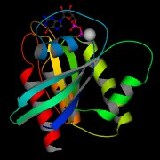
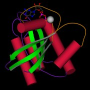
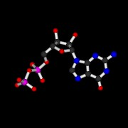

MolScriptSVG 2.3 (development)
==================

New scalar colours: `molauto -bfactor`, `-alphafold`, or
`-alphafold_gradient`. These colour cartoons and ligand atoms, including
banded helix cylinders. See [SCALAR_COLOURS.md](SCALAR_COLOURS.md).
Add an explicit key with `molauto -legend X Y Z WIDTH HEIGHT`, validate a
script without rendering with `molscript -check`, and inspect drawing-command
groups in SVG output. See [legends, checking and SVG groups](ANNOTATIONS_AND_CHECKS.md)
for syntax, examples and limitations.
Further [figure tools](FIGURE_TOOLS.md) add distance/angle annotations, labelled
connectors, adaptive curve sampling, continuous scalar colours, vertical and
categorical keys, and editable reusable view files.
Distance labels now use Å, and B-factor legends use Ų. Thin vector backbones
preserve the original spline exactly: use `turn` to pass through C-alpha atoms,
or `coil` for a smoothed path. See the updated
[backbone example](examples/ras_curved_lines.svg) with C-alpha markers and
[font/smoothing details](FIGURE_TOOLS.md).
Choose label fonts with `-font serif`, `-font sans`, `-font monospace`, or
`set labelfont "Helvetica";` for a backend-native name. See
[output fonts](FONTS.md) for supported formats, FreeType image options and
[comparison previews](examples/index.html#fonts).
Version 2.3 is unreleased; the 2.2 release notes below are historical.

Local HTML documentation starts at [docs/index.html](docs/index.html) or
[README.html](README.html). HTML pages link to HTML companions rather than raw
Markdown. To refresh them after editing the Markdown sources, install
Python-Markdown (`python3-markdown` on Debian/Ubuntu) and run:

```bash
python3 scripts/build-html-docs.py
python3 scripts/build-html-docs.py --check
```

The check requires only Python's standard library and verifies documentation
links, local HTML targets and heading anchors in the generated pages.

Version 2.2 adds display-independent bitmap/FreeType labels, safer geometry,
and fixes across SVG, image export, X3D and MolAuto. The executables remain
`molscript` and `molauto`. Generated example files are included.

See the [2.2 release notes](RELEASE_NOTES_2.2.md), [changelog](CHANGES.md),
[example gallery](examples/index.html) and [release procedure](RELEASING.md).
The repository is [jwm1/MolScriptSVG](https://github.com/jwm1/MolScriptSVG).

Build, run regression tests, and refresh all SVG/PNG examples with:

```bash
make -C code
python3 scripts/test-svg.py
python3 scripts/test-backends-molauto.py
python3 scripts/test-scalar-colours.py
python3 scripts/test-curves.py
python3 scripts/test-annotations.py
python3 scripts/test-figure-tools.py
python3 scripts/test-fonts.py
python3 scripts/test-rendering.py
python3 scripts/test-webgl-browser.py
python3 scripts/test-output-formats.py --images
python3 scripts/regenerate-svg-examples.py
```

The preview script uses CairoSVG when installed, otherwise Inkscape. It checks
SVG XML and PNG signatures and stages new files before replacing old previews.
The format check uses available external readers; `--images` requires Pillow
and working EGL. Headless labels use a bundled bitmap font, with optional
FreeType support. See [RENDERING_TESTS.md](RENDERING_TESTS.md) for font options,
geometry checks, browser tests and remaining coverage gaps.
The [transparency example](examples/svg_transparency.svg) compares opaque and
half-transparent geometry; its [PNG preview](examples/svg_transparency_svg.png)
is also included.

    Copyright (C) 1997-1998 Per J. Kraulis
    Copyright (C) 2026 James W. Murray

<table>
  <tr>
    <td>
      
    </td>
    <td>
      
    </td>
    <td>
      
    </td>
  </tr>
</table>

MolScriptSVG is a fork of MolScript, a program for displaying
molecular 3D structures, such as proteins, in both schematic and
detailed representations. As far as I can tell, MolScript is still the
only program that can produce high quality protein cartoon diagrams in
vector format. This fork extends the output modes of the original
MolScript and fixes OpenGL support.

This fork also includes SVG, MetaPost, POV-Ray, X3D and WebGL-oriented output
backends. SVG, MetaPost, and POV-Ray are written directly from the MolScript
geometry pipeline and do not require any external library at export
time. X3D output is available as both XML (`-x3d`) and Classic
encoding (`-x3dv`). Both Classic and XML X3D are generated natively
inside MolScriptSVG. The `-webgl` mode writes an HTML viewer that
embeds the native XML X3D scene and displays it in the browser using
the X_ITE WebGL runtime.

Notes on syntax coverage and known grammar/doc mismatches are collected in
[UNDOCUMENTED_FEATURES.md](UNDOCUMENTED_FEATURES.md).

Fork-specific modifications in this repository are copyright
James W. Murray. Those modifications were developed with assistance
from OpenAI Codex.

The original documentation is at [pekrau.github.io/MolScript](https://pekrau.github.io/MolScript/).


Open Source
-----------

MolScriptSVG is distributed as a fork under the MIT license in this GitHub
repository. The original MolScript project is available at [MolScript](https://github.com/pekrau/MolScript)

Version MolScriptSVG 2.3
-------------

The first version of MolScript (written in Fortran 77) was released in
1991, and its current version (2.1.2, written in C) in 1998.

This fork keeps the upstream MolScript 2.1.2 language and executable name,
but it is no longer a pristine 1998 code snapshot. The original OpenGL/image
build expected a 1990s GLUT/GLX setup and no longer built cleanly on a modern
Linux system. The `code/Makefile.complete` file has now been modernized to use
`pkg-config` for OpenGL, PNG, JPEG and GIF dependencies.

Build
-----

From the repository root, the default full build is:

```bash
make -C code -j4
```

`code/Makefile` delegates to `Makefile.complete`, so plain `make` builds the
full MolScriptSVG binary by default.

### Makefile summary

- `Makefile`
  - Default entry point.
  - Produces the full build by including `Makefile.complete`.

- `Makefile.complete`
  - Modern Linux-oriented build using `pkg-config`.
  - Enables OpenGL, EGL-backed image rendering, and PNG/JPEG/GIF support by default.

- `Makefile.basic`
  - Minimal build with no OpenGL or OpenGL-backed raster image outputs.
  - Still includes PostScript, SVG, Raster3D, VRML, X3D and WebGL export code.

To build the minimal version explicitly:

```bash
make -C code clean
make -C code -f Makefile.basic -j4
```

To rebuild the full version explicitly:

```bash
make -C code clean
make -C code -f Makefile.complete -j4
```

### Full-build dependencies

On a modern Linux system, the default full build expects `pkg-config` plus
development packages for:

- OpenGL / GLU / GLUT / X11
- EGL
- libpng
- libjpeg
- [libgd](https://libgd.github.io/) for GIF encoding
- zlib

A C compiler, GNU Make and Bison are also required for development builds.
On Debian/Ubuntu, install the full build and optional FreeType dependencies:

```bash
sudo apt install build-essential bison pkg-config freeglut3-dev \
  libgl1-mesa-dev libglu1-mesa-dev libegl1-mesa-dev libx11-dev \
  libpng-dev libjpeg-dev libgd-dev zlib1g-dev libfreetype-dev
make -C code -j4 USE_FREETYPE=1
```

FreeType is opt-in; omit `USE_FREETYPE=1` for bundled bitmap fonts only.
Clean before switching between basic and complete builds. The FreeType toggle
alone is tracked automatically. Test dependencies and optional checks are in
[RENDERING_TESTS.md](RENDERING_TESTS.md).

If those are present, `make` should produce:

- `molscript`
- `molauto`

with support for:

- `-ps`
- `-svg`
- `-mp`
- `-pov`
- `-r3d`
- `-wrl`
- `-x3d`
- `-x3dv`
- `-webgl`
- `-gl`
- `-eps`
- `-epsbw`
- `-sgi`
- `-jpeg`
- `-png`
- `-gif`

### Headless image rendering

The image-output path prefers a headless EGL OpenGL context. That avoids
opening an X11 window and allows `-png`, `-jpeg` and `-gif` rendering without
a working X11 display. If EGL initialization fails, MolScriptSVG falls back to
the hidden GLUT window path for compatibility.

Labels no longer depend on GLUT font initialization. The default
`-labelfont bitmap` uses a bundled printable-ASCII font with Å and ² glyphs.
UTF-8 input is decoded before rasterization. To enable optional
TrueType/OpenType fonts, install the FreeType development package (for example,
`libfreetype-dev` on Debian/Ubuntu), then build with `make -C code USE_FREETYPE=1`.
Select one with `-labelfont freetype -fontfile /path/to/font.ttf`.
Both paths currently use monochrome bitmap glyphs, not antialiased text.
SVG and PostScript label rendering is unchanged.

`MOLSCRIPT_IMAGE_BACKEND=auto|egl|glut` selects the image context; the default
is `auto`. Forced EGL never falls back to X11. Accumulation antialiasing
(`-accum`) uses software accumulation when the context has no accumulation
buffer.

Compare the labelled [bitmap preview](examples/ras_gdp_bitmap.png) and
[FreeType preview](examples/ras_gdp_freetype.png). Commands and test coverage
are in [RENDERING_TESTS.md](RENDERING_TESTS.md).

### Example commands

Build:

```bash
cd code
make
```

Run:

```bash
./molscript -svg -in examples/ras_std.in -out ras_std.svg
./molscript -mp -in examples/ras_std.in -out ras_std.mp
./molscript -pov -in examples/ras_std.in -out ras_std.pov
./molscript -x3d -in examples/ras_std.in -out ras_std.x3d
./molscript -x3dv -in examples/ras_std.in -out ras_std.x3dv
./molscript -webgl -in examples/ras_std.in -out ras_std.webgl.html
```

If `povray` is installed, the generated `.pov` scene files can be rendered to
PNG images with:

```bash
./scripts/render-pov-examples.sh
```

The broader example refresh script:

```bash
./scripts/regenerate-examples.sh
```

will also render `*_pov.png` images automatically when `povray` is available.

The SVG, MetaPost, POV-Ray, X3D and WebGL backends are available in both the basic and complete
builds:

```bash
./molscript -svg -in examples/ras_std.in -out ras_std.svg
./molscript -mp -in examples/ras_std.in -out ras_std.mp
./molscript -pov -in examples/ras_std.in -out ras_std.pov
./molscript -x3d -in examples/ras_std.in -out ras_std.x3d
./molscript -x3dv -in examples/ras_std.in -out ras_std.x3dv
./molscript -webgl -in examples/ras_std.in -out ras_std.webgl.html
```

`molauto` has also been extended with a few modern convenience options:

- `-window n`
- `-rotate a11 a12 a13 a21 a22 a23 a31 a32 a33`
- `-translate x y z`
- `-ss_palette`
- `-colourblind`
- `-publication`

The `-colourblind` preset uses a fixed high-contrast secondary-structure
palette:

- helices: orange
- strands: blue
- coils: green
- turns: yellow-orange

`-x3dv`, `-x3d` and `-webgl` are all generated natively by MolScriptSVG.
The `-webgl` output is a self-contained HTML wrapper around the native XML X3D
scene, but it still loads the X_ITE JavaScript runtime from a CDN at view time.

Fork Changes
------------

This fork differs from the historical 2.1.2 release in a few important ways:

* Added direct SVG output with `-svg`.
* Added MetaPost source output with `-mp`.
* Added POV-Ray scene output with `-pov` / `-povray`.
* Added a POV-Ray example render script and rendered `*_pov.png` example images.
* Added X3D output in both XML (`-x3d`) and Classic (`-x3dv`) encodings.
* Added HTML WebGL viewer output with `-webgl`, backed by the X3D scene exporter.
* Modernized the OpenGL build in `code/Makefile.complete` for current Linux
  systems using `pkg-config`.
* Restored OpenGL-backed PNG, JPEG and GIF image export on modern systems.
* Updated the examples gallery to work from a local filesystem checkout and to
  include the generated SVG assets.
* XML X3D and WebGL are generated natively, without an external converter.
* MetaPost output can optionally include projected axes and semantic comments.
* POV-Ray output now uses fitted orthographic cameras and softer multi-light
  scene defaults for rendered examples.

Release Status
--------------

The current tree has been smoke-tested for:

* `-svg`
* `-mp`
* `-x3d`
* `-x3dv`
* `-webgl`
* OpenGL interactive mode via `-gl`
* OpenGL-backed `-png`, `-jpeg` and `-gif`

The generated example outputs under `examples/` are intended to be part of the
repository for comparison and regression checking.

For a quick smoke test after building:

```bash
./scripts/smoke-test.sh
```


Reference
---------

    Per J. Kraulis
    MOLSCRIPT: a program to produce both detailed and schematic plots of
    protein structures.
    J. Appl. Cryst. (1991) 24, 946-950

This paper is now available under Open Access: [PDF](docs/kraulis_1991_molscript_j_appl_cryst.pdf)

[DOI:10.1107/S0021889891004399](https://doi.org/10.1107/S0021889891004399)

[Publisher's PDF](https://journals.iucr.org/j/issues/1991/05/00/gl0206/gl0206.pdf)
